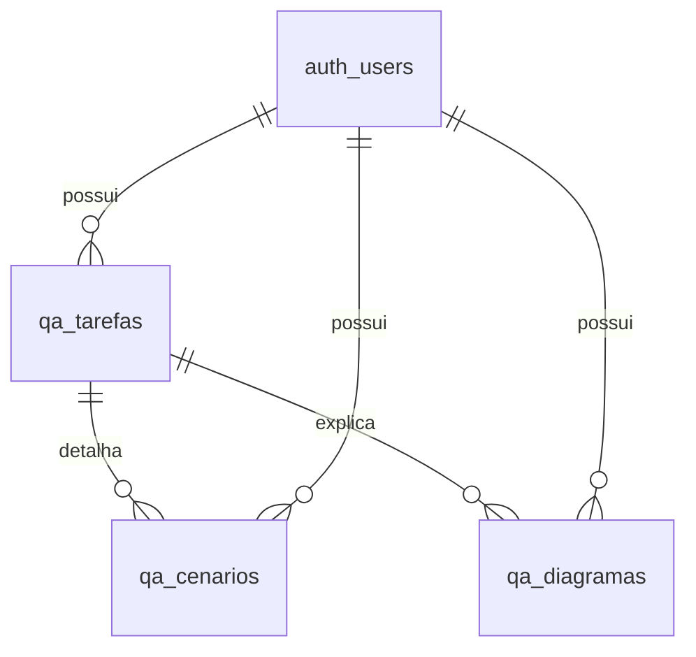

# Plano de evolução — QA Hub

## 1. Objetivo

Transformar o projeto público `kaina-visualsoftware/Tarefas`, hoje um índice de páginas estáticas por pasta, em sistema de gestão pessoal de testes de software, preservando `184728/page.html` e a experiência do hub legado.

**Diretriz visual:** produto de operação diária, com alta legibilidade, densidade equilibrada, foco em busca, leitura de relatórios e registros extensos, sem excesso de animações.

## 2. Funcionalidade e prioridades

| Prioridade | Área | Contrato de uso |
| --- | --- | --- |
| P0 | TF | Criar, editar, excluir e localizar teste; BUILD/RELEASE; situação; versão; código; ambiente |
| P0 | Cenário | Uma TF possui N cenários ordenados; passos, esperado, observado, resultado, notas |
| P0 | Resultado final | Erro reproduzido, funcionamento, conclusão e observações |
| P0 | Acesso | Supabase Auth; proprietário acessa somente seus registros via RLS |
| P1 | Importador | Colar relatório de QA existente e dividir em TF/cenários, revisar antes de concluir |
| P1 | Explicações | Documentar problema, causa, correção e fluxo esperado |
| P1 | Diagramas | Editor Mermaid, persistência e visualização segura |
| P1 | Dashboard | KPIs e distribuição de situações/tipos |
| P2 | Evidências | Anexos em Supabase Storage privado, links temporários, metadados por cenário |
| P2 | Pesquisa | Busca full-text, filtros combinados, paginação server-side |
| P2 | Relatórios | Geração PDF e exportação JSON/CSV, comparação por versão e por módulo |
| P2 | Colaboração | Times, responsáveis, permissões de leitura/edição e comentários |
| P3 | Automação | Importação de resultados automatizados (Playwright/JUnit), trilha de auditoria |
| P3 | Insights | Cobertura por módulo, regressões por versão, indicadores históricos |

## 3. Modelo de dados inicial

**Entidades:** `qa_tarefas` (1 por TF/teste), `qa_cenarios` (N por TF), `qa_diagramas` (N por TF). Cada entidade tem `user_id` e RLS; filhos conferem a titularidade do pai. Todos os registros usam UUID. `status` é uma decisão expressa pelo testador, não uma conclusão inferida de descrição livre.

No formato do exemplo de promoção: a descrição, conclusão e observações ficam na TF; os onze blocos “CENÁRIO 1…11” tornam-se onze registros filhos. A gravação como tipo “Valor por Produto” é preservada como observação/documentação, não como enum especial.

## 4. Entrega em fases

### Fase 0 — Preservação e especificação
- [x] Inspecionar repositório e identificar tecnologia legada.
- [x] Criar branch isolada e não alterar a pasta `184728/`.
- [x] Definir esquema, UX e critérios de segurança.
- [x] Identificar skills do BlockDOM úteis para o projeto.

### Fase 1 — Fundação e experiência (implementada no código, sem homologação)
- [x] Layout de dashboard e editor.
- [x] Tabelas e RLS versionadas em SQL.
- [x] Autenticação via SDK Supabase.
- [x] CRUD de TF/cenário/diagrama.
- [x] Filtros e KPIs básicos.
- [x] Importação inicial de texto formatado.
- [x] Diagrama Mermaid e gráfico de situação.
- [ ] Aplicar migração ao projeto autorizado e validar banco.
- [ ] Confirmar experiência real em navegadores.

### Fase 2 — Qualidade e evidências
- [ ] Supabase Storage privado com políticas por proprietário/TF.
- [ ] Evidências em imagens e PDFs com limite de tamanho e validação MIME.
- [ ] Paginação, índices de pesquisa e pesquisa textual no servidor.
- [ ] Histórico de alterações e soft-delete/recuperação.
- [ ] Exportação PDF/CSV e modelo para impressão.
- [ ] CI com testes automatizados de importação, autenticação, RLS e UI.

### Fase 3 — Inteligência de QA
- [ ] Painel de evolução por período/versão/módulo.
- [ ] Biblioteca de cenários reutilizáveis e modelo padrão BUILD/RELEASE.
- [ ] Comparação de execuções para identificar regressão.
- [ ] Times e compartilhamento com modelo explícito de autorização.
- [ ] Integração opcional com GitHub Issues e Playwright.

## 5. Critérios de aceite obrigatórios para homologar a Fase 1

1. Login, cadastro com confirmação e logout sem expor sessão a outras contas.
2. Usuário A não consegue SELECT/INSERT/UPDATE/DELETE em registros do usuário B, nem vincular cenários de outro proprietário.
3. CRUD de TF, cenários e diagramas persiste após refresh.
4. Importador separa corretamente 11 cenários do relatório de promoção; mantém ordem, passos e flags finais.
5. Dados importados iniciam como rascunho, sem validação automática fictícia.
6. Erros de banco e rede são exibidos sem perda do texto de edição.
7. Mermaid não executa scripts, HTML arbitrário nem links inseguros.
8. Busca por código, título, versão e módulo encontra a TF esperada.
9. Dashboard reflete TFs aprovadas, em teste, reprovadas e bloqueadas.
10. Interface em 390×844, 768×1024 e 1366×768; teclado, foco e contraste legíveis.
11. Nenhuma credencial de banco, secret key, dado confidencial ou relatório real no repositório.

## 6. Skills e abordagem

Fonte: `kaina-visualsoftware/BlockDOM/.agents/skills/`; usar princípios de design, a11y, segurança, Playwright, TDD e revisão. Skills específicas do Blockly/ensino são preservadas como referência histórica mas não introduzem Blockly no QA Hub. Supabase skill e boas práticas PostgreSQL consultadas separadamente. Não instalar dependências ou executáveis de terceiros indiscriminadamente.

## 7. Riscos e decisões

- **Projeto Supabase fora do escopo autorizado:** SQL versionado, aplicação remota pendente.
- **Relatórios reais contêm informação operacional:** não registrar dados em exemplos públicos.
- **Importação textual não equivale a execução de testes:** manter rascunho e exigir revisão.
- **MVP sem transação atômica de importação:** resultado parcial é informado ao usuário; migração futura para RPC transacional.
- **CDNs:** manter versões fixas e preparar pipeline de bundle/SRI em produção.
- **Escala:** contagem atual da interface é limitada; implementar paginação/estatísticas por query antes de uso intensivo.
